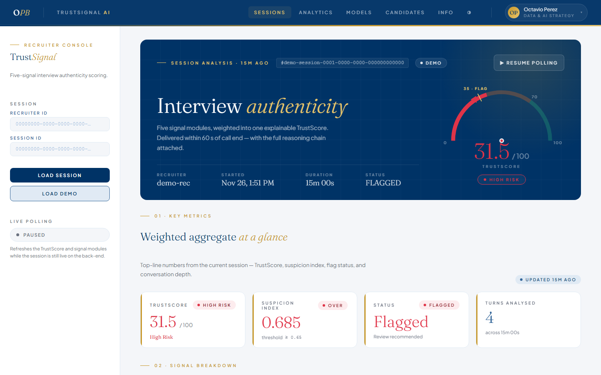
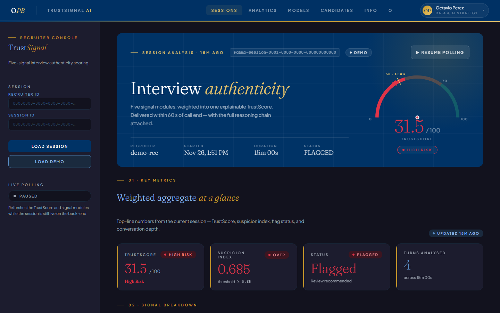
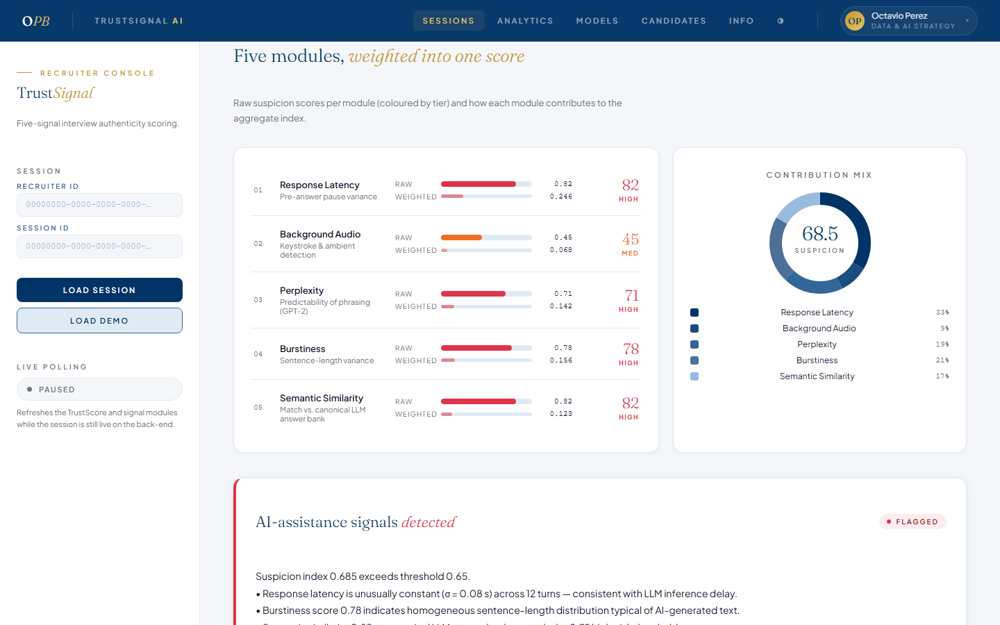
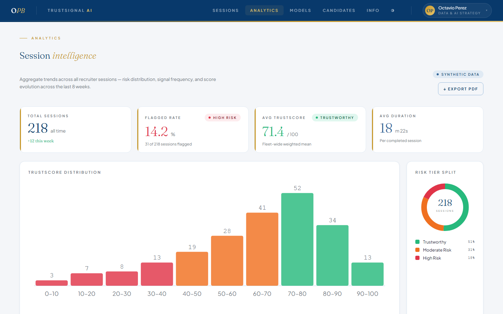
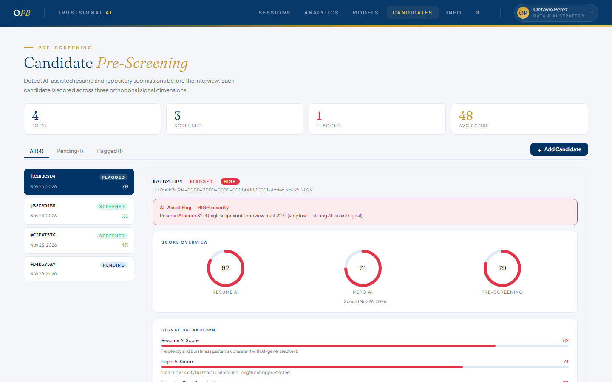
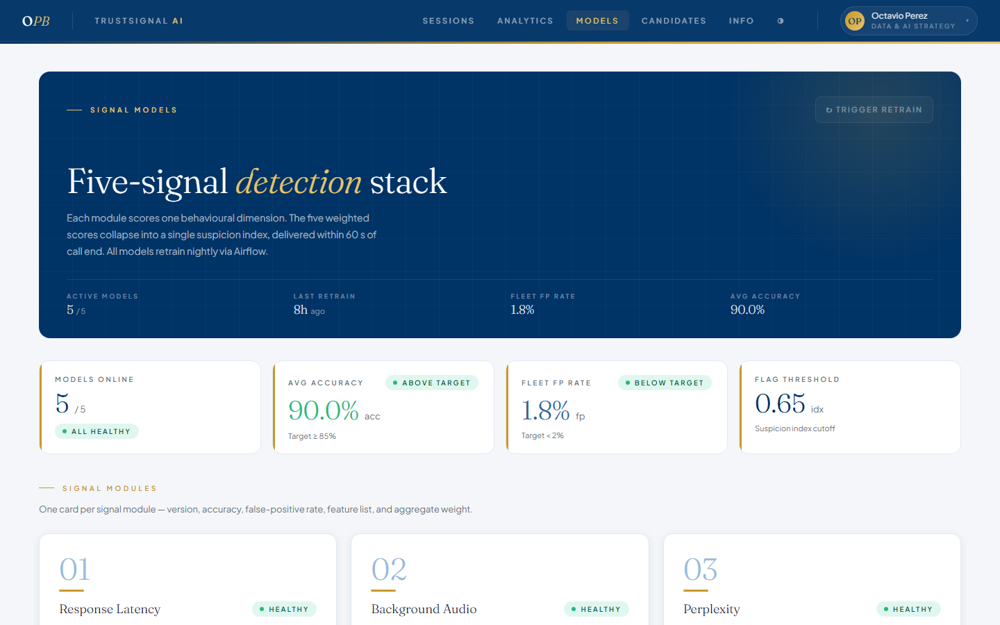

# TrustSignal AI

[](https://github.com/OctavioPB/Trust_Signal_AI/actions/workflows/ci.yml)
[](https://github.com/OctavioPB/Trust_Signal_AI/actions/workflows/ci.yml)
[](tests/)
[](https://github.com/astral-sh/ruff)
[](frontend/e2e/)


**Interview authenticity scoring powered by hybrid streaming + batch analytics.**

TrustSignal AI detects AI-assisted interview fraud in real time and delivers a
**TrustScore (0–100)** to recruiters within 60 seconds of call end. Five independent
signal modules analyse the audio and transcript of each interview; a weighted
aggregation engine combines them into a single, explainable score.

> Built by **OPB — Octavio Pérez Bravo · Data & AI Strategy Architect**

---

## Screenshots

All screenshots run in demo mode with synthetic data, so no backend is needed.

**Session analysis.** Live TrustScore gauge, flag status and key metrics for one interview.



**Dark theme.** Toggle it with ◐ in the top bar; the choice is saved in the browser.



**Signal breakdown.** Raw and weighted score for each of the five modules, plus the contribution mix and the plain-language reasons for the flag.



<table>
  <tr>
    <td width="50%"><b>Analytics</b>: TrustScore distribution and risk tiers across all sessions.<br></td>
    <td width="50%"><b>Candidate pre-screening</b>: resume and repository AI scores before the interview.<br></td>
  </tr>
  <tr>
    <td colspan="2"><b>Signal models</b>: health, accuracy, false-positive rate and weight for each detection module.<br></td>
  </tr>
</table>

To regenerate them, run `npm run dev` and then, in a second terminal, `npm run screenshots` (both in `frontend/`).

---

## Business Case

| KPI | Target |
|-----|--------|
| Time-to-fraud-detection | Within the first 10 minutes of the interview |
| False positive rate | < 2 % (never penalise nervous-but-legitimate candidates) |
| TrustScore delivery | ≤ 60 s after `POST /session/{id}/end` |

---

## Architecture

```
WebRTC / WebSocket audio
          │
          ▼
  Kafka: interview-audio-stream  (24 h retention, 3 partitions)
          │
          ▼  (Python consumer — ThreadPoolExecutor STT)
  OpenAI Whisper STT
          │
          ├──► MinIO raw-audio/  (90-day lifecycle policy)
          │
          ▼
  Kafka: interview-text-stream  (7 d retention, 3 partitions)
          │
          ▼
  Delta Lake  ←── DeltaWriter (ACID upserts)
          │
          └──► ML Signal Pipeline
                  ├── latency.py       Response Latency    (weight 0.30)
                  ├── audio_bg.py      Background Audio    (weight 0.15)
                  ├── perplexity.py    LM Perplexity       (weight 0.20)
                  ├── burstiness.py    Burstiness          (weight 0.20)
                  └── similarity.py   Semantic Similarity  (weight 0.15)
                            │
                            ▼
                    trust_score.py → TrustScore 0–100
                            │
                            ▼
                    FastAPI (port 8000)
                            │
                    ┌───────┴────────┐
                    ▼               ▼
            React Dashboard    Streamlit (legacy)
            (Vite, port 5173)  (port 8501)
```

**Nightly Batch (Airflow DAG):**
Delta Lake → extract suspicious → embed → retrain classifiers → update answer bank → Slack notify

---

## Pre-Screening Architecture

Candidates are evaluated *before* the interview via resume and repository analysis.

```
Recruiter uploads resume / links GitHub repo
          │
          ├──► Kafka: candidate-resume-stream   (resume text + candidate_uuid)
          │              │
          │              ▼  (Airflow DAG: resume_scoring_dag)
          │         Resume AI Detector
          │           ├── LM Perplexity       (weight 0.40)
          │           ├── Burstiness          (weight 0.25)
          │           ├── Vocab Richness      (weight 0.20)
          │           └── Section Uniformity  (weight 0.15)
          │                     │
          │                     ▼  suspicion score 0–1
          │
          └──► Kafka: candidate-repo-stream    (repo contents + candidate_uuid)
                         │
                         ▼  (Airflow DAG: repo_scoring_dag)
                    Repo AI Detector
                      ├── Code-LM Perplexity  (weight 0.35)
                      ├── Commit Consistency  (weight 0.25)
                      ├── Comment Ratio       (weight 0.20)
                      └── Naming Entropy      (weight 0.20)
                                │
                                ▼  suspicion score 0–1
          │
          ▼  (both scores written to Delta Lake: candidate_prescreening)
    Pre-Screening Aggregator
      weighted_score = 0.60 × resume_score + 0.40 × repo_score
      flagged        = weighted_score ≥ PRESCREENING_THRESHOLD (default 0.50)
          │
          ├──► FastAPI  GET /candidates/{id}/report
          │
          └──► ATS Webhook (Greenhouse / Lever)
                  payload: { candidate_uuid, prescreening_score, flags }
                  retry:   3 retries × exponential back-off (10 s / 30 s / 90 s)
                  DLQ:     Delta Lake webhook_dlq on permanent failure
```

**No PII in any Kafka payload or webhook.** Only `candidate_uuid` travels through the pipeline; names and emails remain in the recruiter database only.

---

## Signal Modules

| Module | What it measures | High suspicion indicator |
|--------|-----------------|--------------------------|
| **Response Latency** | CV of inter-turn latency | CV < 0.15 (constant ≈ LLM + TTS delay) |
| **Background Audio** | MFCC-based keyboard detection | Keyboard detected during silence windows |
| **Perplexity** | LM perplexity of transcript | ppl < 30 (too predictable — AI-generated) |
| **Burstiness** | Sentence-length CV | CV < 0.20 (homogeneous — AI-generated) |
| **Semantic Similarity** | Max cosine vs. LLM answer bank | similarity > 0.65 |

TrustScore formula:

```
suspicion_index = Σ (signal_score_i × weight_i)   ∈ [0, 1]
TrustScore      = (1 − suspicion_index) × 100      ∈ [0, 100]
flagged         = suspicion_index ≥ 0.65
```

---

## Nightly Retraining DAG

`airflow/dags/retraining_dag.py` — scheduled daily at **02:00 UTC**.

**Labels come only from human review.** The DAG never trains on the system's own flags: that would be a feedback loop in which a false positive is learned as a positive and makes similar honest answers look more suspicious the next night. A reviewer confirms or clears each flag (`POST /session/{id}/review`, or the buttons on the flag panel); verdicts go to an append-only review log (`session_reviews/`, one Parquet file per review, reviewer stored only as a pseudonymous hash). Confirmed sessions are positives; cleared sessions are negatives, the audio and answers the model got wrong.

### Task Dependency Graph

```
  ┌─────────────────────┐
  │  extract_suspicious  │  Query Delta Lake for suspicious_flag=true
  │  (DuckDB scan)       │  segments from the past 24 h
  └──────────┬──────────┘
             │
             ▼
  ┌──────────────────────┐
  │  compute_embeddings  │  Batch-embed CANDIDATE texts with
  │  (sentence-xformers) │  all-MiniLM-L6-v2; update vector store
  └──────────┬───────────┘
             │
             ▼
  ┌───────────────────────────┐        ┌──────────────────────┐
  │  retrain_bg_classifier    │──────► │  update_answer_bank  │
  │  (RandomForest + MFCC)    │        │  (append JSONL pairs) │
  │  → YYYYMMDD_bg_clf.pkl   │        └──────────┬───────────┘
  └──────────────┬────────────┘                   │
                 │                                ▼
                 │                     ┌────────────────────────┐
                 │                     │  generate_llm_answers  │
                 │                     │  (Ollama: Gemma→Qwen)  │
                 │                     └──────────┬─────────────┘
                 └──────────────┬─────────────────┘
                                ▼
                       ┌──────────────┐
                       │    notify    │  Slack Block Kit summary:
                       │  (requests)  │  segments, embeddings, classifier,
                       └──────────────┘  answer bank pairs
```

### Task Details

| Task | Description |
|------|-------------|
| `extract_suspicious` | DuckDB join of `transcript_segments` with the latest review per session; keeps sessions reviewed in the 24 h window, each tagged `confirmed` or `cleared`. Unreviewed flags are ignored |
| `compute_embeddings` | Embeds CANDIDATE texts from confirmed sessions only; appends to `VECTOR_STORE_PATH/{embeddings.npy, metadata.json}` |
| `retrain_bg_classifier` | Downloads reviewed-session audio from MinIO; labels it by verdict (confirmed = 1, cleared = 0); retrains `BackgroundAudioClassifier` if ≥ 10 samples and both classes are present; uploads `YYYYMMDD_bg_classifier.pkl` to `model-artifacts/` |
| `update_answer_bank` | Extracts RECRUITER→CANDIDATE Q&A pairs from confirmed sessions only; deduplicates; appends to `data/llm_answer_bank.jsonl` |
| `generate_llm_answers` | Answers up to `LLM_ANSWER_GEN_MAX` bank questions with the local LLM router (Gemma, falling back to Qwen); appends entries tagged with `source_model`. If Ollama is unreachable it logs and appends nothing; the DAG does not fail |
| `notify` | Sends Slack Block Kit payload to `SLACK_WEBHOOK_URL`; falls back to structured log if env var not set |

All tasks inherit `retries=2`, `retry_delay=timedelta(minutes=5)` from `DEFAULT_ARGS`.

---

## Tech Stack

| Layer | Technology |
|-------|-----------|
| Message broker | Apache Kafka (3 partitions, consumer-group horizontal scaling) |
| Object storage | MinIO (local) / AWS S3 (prod) |
| Table format | Delta Lake (PySpark + delta-spark) |
| Orchestration | Apache Airflow (`@daily` DAG) |
| STT | OpenAI Whisper (local, ThreadPoolExecutor) / Cloud Whisper fallback |
| Embeddings | Sentence-Transformers `all-MiniLM-L6-v2` |
| Audio classification | LibROSA (MFCC) + scikit-learn RandomForest |
| NLP scoring | HuggingFace `distilgpt2` (perplexity) |
| Local LLM routing | Ollama: Gemma (`gemma4:26b-a4b-it-qat`) with Qwen (`qwen3:4b-instruct-2507-q4_K_M`) fallback; generates LLM answer-bank entries nightly |
| API | FastAPI + JWT HS256 + Pydantic + CORSMiddleware |
| React dashboard | React 19 + TypeScript 6 + Vite 8 + Zustand 5 |
| Legacy dashboard | Streamlit + Plotly (retained for reference) |
| Ad-hoc queries | DuckDB `parquet_scan()` over Delta tables |
| Observability | structlog (JSON) — no PII in logs; optional Sentry integration |
| Metrics | Prometheus (`prometheus-fastapi-instrumentator`) — custom gauges + histograms |
| Rate limiting | slowapi — 100 req/min per API key; 429 + Retry-After on breach |
| ATS delivery | httpx + retry/backoff + Delta Lake DLQ (Greenhouse, Lever) |

---

## Repository Structure

```
trustsignal/
├── api/
│   ├── main.py                  FastAPI app wiring (CORS, rate limiter, Prometheus, routers)
│   ├── auth.py                  Shared JWT bearer authentication (_ALGORITHM, _bearer, _auth)
│   ├── candidates.py            Candidate CRUD + resume upload + repo link + trigger endpoints
│   ├── rate_limiter.py          slowapi limiter — 100 req/min per API key, token-prefix keying
│   ├── webhooks.py              ATS webhook delivery: retry/backoff/DLQ (Greenhouse, Lever)
│   └── metrics.py               Prometheus gauges + histograms; instruments FastAPI on /metrics
├── airflow/
│   ├── dags/
│   │   ├── retraining_dag.py    Nightly retraining DAG — 02:00 UTC (5 tasks)
│   │   ├── resume_scoring_dag.py  Nightly resume AI-detection scoring — 03:00 UTC
│   │   └── repo_scoring_dag.py  Nightly repository AI-detection scoring — 04:00 UTC
│   └── sensors/
│       └── kafka_lag_sensor.py  Waits for Kafka consumer group lag = 0
├── frontend/                    React 19 + TypeScript 5.4 + Vite 5 dashboard
│   ├── src/
│   │   ├── App.tsx              Nav + switch/case page routing (no router library)
│   │   ├── types.ts             TypeScript interfaces matching FastAPI Pydantic models
│   │   ├── services/api.ts      Typed fetch wrapper (ApiError class)
│   │   ├── pages/
│   │   │   ├── CandidatesPage.tsx  Pre-screening UI: gauges, signal bars, upload, ATS alerts
│   │   │   ├── SettingsPage.tsx    ATS webhook URL config per integration
│   │   │   └── InfoPage.tsx        System info: Kafka topics, ML models, workflow steps
│   │   ├── stores/
│   │   │   ├── candidatesStore.ts  Zustand: candidate list, upload, repo link, pre-screen
│   │   │   ├── demoStore.ts        Zustand: synthetic flagged-session demo payload
│   │   │   └── themeStore.ts       Zustand: light/dark toggle + localStorage persist
│   │   └── styles/tokens.css    CSS custom properties from BRAND.md
│   ├── index.html               Google Fonts (Fraunces + Plus Jakarta Sans)
│   └── vite.config.ts           /api proxy → http://localhost:8000
├── dashboard/
│   ├── legacy/app.py            Streamlit recruiter dashboard (legacy — Sprint 8)
│   ├── api_client.py            HTTP client for FastAPI
│   └── pdf_export.py            PDF report generation (fpdf2)
├── ingestion/
│   ├── producer.py              WebRTC/WS → Kafka (interview-audio-stream)
│   ├── consumer.py              Kafka → STT (ThreadPoolExecutor) → interview-text-stream
│   ├── resume_parser.py         PDF/DOCX/TXT → structured ParsedResume (sections + full_text)
│   └── repo_producer.py         GitHub repo crawler → candidate-repo-stream events
├── ml/
│   ├── features/
│   │   ├── latency.py           Response latency CV scorer (interview)
│   │   ├── audio_bg.py          MFCC + RandomForest keyboard detector (interview)
│   │   ├── perplexity.py        distilgpt2 perplexity scorer (interview)
│   │   ├── burstiness.py        Sentence-length CV scorer (interview)
│   │   ├── resume_perplexity.py LM perplexity on resume text (pre-screening)
│   │   ├── resume_burstiness.py Sentence-length CV on resume text (pre-screening)
│   │   ├── vocab_richness.py    MTLD vocabulary richness scorer (pre-screening)
│   │   ├── section_uniformity.py  Section-length variance scorer (pre-screening)
│   │   ├── code_perplexity.py   Code-LM perplexity via CodeBERT/StarCoder (pre-screening)
│   │   ├── code_style.py        Style consistency scorer across files (pre-screening)
│   │   └── commit_pattern.py    Commit authorship variance analyser (pre-screening)
│   ├── embeddings/
│   │   └── similarity.py        Cosine similarity vs. LLM answer bank
│   ├── trust_score.py           Weighted aggregation → TrustScore (interview)
│   ├── resume_score.py          Weighted aggregation → resume suspicion score
│   ├── repo_score.py            Weighted aggregation → repo suspicion score
│   ├── prescreening_score.py    Combined resume + repo → pre-screening verdict
│   └── cross_correlation.py     Resume/repo coherence cross-signal scorer
├── storage/
│   ├── delta_writer.py          PySpark + delta-spark ACID upserts
│   ├── object_store.py          MinIO audio + artifact persistence + GDPR deletion
│   └── lifecycle.py             MinIO 90-day lifecycle policy
├── transcription/
│   └── whisper_service.py       Whisper STT wrapper
├── data/
│   └── llm_answer_bank.jsonl    59+ canonical AI interview answer Q&A pairs
├── docs/
│   └── DPA_TEMPLATE.md          GDPR Data Processing Agreement template
├── research/
│   ├── notebooks/
│   │   ├── audio_bg_eda.ipynb      MFCC feature EDA + classifier training
│   │   ├── nlp_signals_eda.ipynb   Perplexity + burstiness + similarity EDA
│   │   └── bias_audit.ipynb        FP-rate audit across demographic + style subgroups
│   └── model_cards/
│       ├── resume_detector.md      Model card: type, features, FP rates, bias audit, limits
│       └── repo_detector.md        Model card: type, features, FP rates, bias audit, limits
├── scripts/
│   ├── smoke_test.sh            Service health checks
│   ├── pii_audit.py             Scans source + logs for PII variable names
│   └── query_delta.py           DuckDB CLI for Delta Lake ad-hoc queries
├── tests/
│   ├── unit/                    Isolated tests; no I/O; models mocked
│   └── integration/             Full-stack tests (load, lifecycle, GDPR, webhooks)
├── config.py                    Centralised env-var loading (python-dotenv)
├── logging_setup.py             structlog JSON config + bind_log_context / clear_log_context
├── docker-compose.yml           Kafka, MinIO, Airflow, Spark local stack
└── planning/
```

---

## How to Run Locally

### Prerequisites

- Docker & Docker Compose
- Python 3.11+
- Node.js 18+ and npm

### 1. Start the infrastructure stack

```bash
docker-compose up -d
```

| Service | Local port |
|---------|-----------|
| Kafka broker | 9095 |
| MinIO API | 9200 |
| MinIO console | 9201 |
| Airflow webserver | 8083 |
| Spark master UI | 8090 |

### 2. Install Python dependencies

```bash
pip install -r requirements.txt
# Optional: PDF export and Streamlit dashboard
pip install fpdf2 streamlit plotly
```

### 3. Configure environment

```bash
cp .env.example .env
# Edit .env — set FASTAPI_SECRET_KEY at minimum; defaults work for local dev
```

### 4. Run the API

```bash
uvicorn api.main:app --reload --port 8000
```

API docs: `http://localhost:8000/docs`

### 5. Run the React dashboard (primary UI)

```bash
cd frontend
npm install       # first time only — installs React, Vite, Zustand, Vitest, Playwright
npm run dev       # starts Vite dev server
```

Open **http://localhost:5173**

- Click **Load Demo** in the left sidebar to explore a synthetic flagged session (TrustScore 31.5, suspicion 0.685) — no API needed.
- To connect to a live session: enter a Recruiter ID → click **Load Session** → enter a Session ID.

> **Vite proxy:** all `/api/*` requests are forwarded to `http://localhost:8000` automatically. No manual CORS configuration is required during development.

#### Frontend scripts

| Command | What it does |
|---------|-------------|
| `npm run dev` | Vite HMR dev server on port 5173 |
| `npm run build` | Production build → `frontend/dist/` |
| `npm run preview` | Preview production build locally |
| `npm run lint` | ESLint (TypeScript strict) |
| `npm test` | Vitest unit tests (fetch mocked) |
| `npx playwright test` | Playwright e2e smoke tests (requires dev server) |
| `npm run screenshots` | Regenerate the README screenshots in `docs/screenshots/` (requires dev server) |

#### Playwright setup (first time)

```bash
cd frontend
npx playwright install chromium   # downloads Chromium browser
npx playwright test               # runs e2e/demo.spec.ts
```

### 6. Run the legacy Streamlit dashboard (optional)

```bash
streamlit run dashboard/legacy/app.py
```

Open `http://localhost:8501` → click **Load Demo Data**.

> The Streamlit dashboard is retained for reference only. The React app (`frontend/`) is the primary UI for all new work.

### 7. Run tests

```bash
pytest tests/unit/ -v
pytest tests/integration/ -v   # requires Docker stack
pytest --cov                   # coverage report (fails below 60 %)
ruff check .                   # lint
```

CI ([.github/workflows/ci.yml](.github/workflows/ci.yml)) runs all of these on every push and pull request, along with the PII audit, ESLint, the frontend build, Vitest with coverage and the Playwright e2e tests.

### 8. Trigger a manual DAG run (dev only)

```bash
airflow dags trigger trustsignal_nightly_retraining
```


---

## Detection Evaluation

`evals/` holds a labelled evaluation set and a CI gate, so every accuracy claim is measured and every change to a signal, weight or the answer bank is checked for regressions. The **Detection evaluation gate** CI job fails if AUROC or TPR at 1% FPR drops, or any human group's flag rate rises, against [evals/baseline.json](evals/baseline.json).

**The set (650 texts).** Third-party text is downloaded at build time from pinned commits and verified by SHA-256, never committed.

| Group | Label | n | Source |
|---|---|---|---|
| `web_qa` | human | 150 | [HC3](https://huggingface.co/datasets/Hello-SimpleAI/HC3) `open_qa` human answers (CC-BY-SA-4.0) |
| `chatgpt_qa` | AI | 150 | HC3 ChatGPT answers to the same questions |
| `native_essay` | human | 88 | Hewlett 8th-grade essays ([Liang et al. 2023](https://github.com/Weixin-Liang/ChatGPT-Detector-Bias)) |
| `non_native_essay` | human | 91 | TOEFL essays (Liang et al.) |
| `gpt4_polished` | AI-assisted | 91 | the same TOEFL essays polished by GPT-4 |
| `local_llm` | AI | 40 | interview answers from local Gemma and Qwen ([evals/data/local_llm.jsonl](evals/data/local_llm.jsonl)) |
| `paraphrased` | AI | 40 | those answers rewritten by Qwen to sound spoken |

Q&A pairs need at least 40 words on both sides, so answer length alone can't separate the classes.

**Baseline (2026-11-26).** Group flag rates use the threshold that gives 5% false positives overall.

| Scorer | AUROC | TPR @ 1% FPR | Non-native flag rate | Native flag rate |
|---|---|---|---|---|
| Fused, as the API runs it | 0.856 | 0.196 | 16.5% | 1.1% |
| Calibrated fusion, perplexity (`ml/fusion.py`, cross-fitted) | 0.864 | 0.193 | 16.5% | 1.1% |
| **Calibrated fusion, Binoculars** (cross-fitted) | **0.950** | **0.548** | 17.6% | 0.0% |
| Burstiness | 0.851 | 0.237 | 15.4% | 2.3% |
| Perplexity (`distilgpt2`) | 0.726 | 0.000 | 0.0% | 0.0% |
| **Binoculars** (SmolLM2-135M pair) | **0.912** | **0.495** | 8.8% | 0.0% |
| Semantic similarity | 0.570 | 0.134 | 14.3% | 3.4% |
| Vocabulary richness | 0.431 | 0.000 | 0.0% | 18.2% |

What the baseline shows:
- **Text-only sessions are never flagged.** Without audio the two audio signals count as 0, so the suspicion index tops out at 0.55, below the 0.65 threshold. Renormalised over the text signals, 0.65 flags 68% of AI texts but also 18.5% of human texts, against a 2% target.
- **Non-native writers are flagged 15× more often than native writers** at the same threshold, reproducing [Liang et al.](https://arxiv.org/abs/2304.02819) in this system.
- **Perplexity saturates.** Its score caps at 1.0 for perplexity ≤ 30, and 27% of human texts hit the cap, so no threshold reaches 1% FPR.
- **Vocabulary richness is worse than chance** (AUROC 0.43) on this data. Burstiness abstains on 149 texts with fewer than 3 sentences.
- **Paraphrasing works as an evasion:** 90% of local LLM answers are flagged, but only 37.5% after a casual rewrite.

### Calibrated scoring (opt-in)

[ml/fusion.py](ml/fusion.py) replaces the hand-set weighted sum with:
- **Missing signals modelled, not zeroed.** Each signal enters as its score plus a "not available" indicator.
- **Fusion in log-odds space.** A logistic model with non-negative signal weights gives a calibrated probability. Each signal's contribution is additive, and raising a signal can never lower suspicion (property-tested with Hypothesis).
- **A conformal threshold.** The flag threshold is set on held-out human texts so that, for human sessions like them, P(flagged) ≤ α = 2%.

Held-out results at the conformal threshold (5-fold cross-fitting; no text is scored by a model that saw it):

| | Legacy, as the API runs it | Calibrated, perplexity | Calibrated, Binoculars |
|---|---|---|---|
| False-positive rate | 0% (flags nothing) | 1.8% | **1.5%** (target ≤ 2%) |
| AI texts caught | 0% | 22.1% | **59.2%** |
| ChatGPT answers caught | 0% | 29.3% | **82.0%** |
| Paraphrased answers caught | 0% | 5.0% | **42.5%** |
| Calibration error (ECE) | 0.230 | 0.061 | **0.053** |
| Flag rate, non-native vs native essays | n/a | 6.6% vs 0% | 5.5% vs 0% |

The guarantee covers human sessions overall, not each group: non-native writers are still flagged more often. The model learns weight 0 for latency and background audio because the set has no audio, so it stays **opt-in**. Train it with `python -m ml.train_fusion` and serve it with `FUSION_MODEL_PATH=ml/artifacts/<date>_fusion.json`. The default stays the legacy engine until reviewed sessions with audio (`POST /session/{id}/review`) can train the audio weights.

### Binoculars text detector

[ml/features/binoculars.py](ml/features/binoculars.py) implements [Binoculars](https://arxiv.org/abs/2401.12070): the ratio of a model's perplexity on the text to how surprising one model finds another model's predictions for it. That normalisation is why it holds up where raw perplexity saturates. `TEXT_DETECTOR=binoculars` (the default) selects it through [ml/features/text_detector.py](ml/features/text_detector.py) for the API's `perplexity` slot. The paper used Falcon-7B. Pairs that run on CPU, compared with `python -m evals.compare_binoculars`:

| Observer / performer | AUROC | TPR @ 1% FPR | CPU s / text |
|---|---|---|---|
| **SmolLM2-135M / -Instruct** (default) | **0.912** | 0.495 | **0.40** |
| SmolLM2-360M / -Instruct | 0.904 | **0.545** | 0.95 |
| Qwen2.5-0.5B / -Instruct | 0.803 | 0.265 | 1.47 |

The 360M pair's lead at 1% FPR is about 17 texts, within noise at this sample size, at 2.4× the CPU cost. Set `BINOCULARS_OBSERVER` / `BINOCULARS_PERFORMER` to switch, and re-derive `BINOCULARS_MIDPOINT` from the class medians the comparison prints. The set is written text, not speech transcripts; spoken-interview data is the next gap to close.

### Early detection that survives repeated checks

A live dashboard re-checks the score after every turn, and each look is another chance to flag an honest candidate by luck. [ml/sequential.py](ml/sequential.py) adds evidence turn by turn, as in Wald's sequential test. Each candidate turn's Binoculars score becomes a clipped log-likelihood ratio, and the running sum is flagged the first time it crosses a threshold. The threshold is set conformally on the **maximum** the running evidence reaches in held-out human sessions. A human session is ever flagged only if its peak crosses it, so P(ever flagged) ≤ α however often the score is polled. This doesn't assume turns are independent, which one person's turns aren't.

`python -m evals.sequential` splits each evaluation text into 2-sentence turns (650 sessions, median 3 turns) and cross-fits by session:

| Rule, checked after every turn | False-positive rate | AI sessions caught |
|---|---|---|
| Running average vs a threshold set for one final look (typical dashboard) | **9.7%** (1.8% if checked only once) | 62.3% |
| Summed evidence vs a one-look threshold | 2.7% (2.4% if checked only once) | 43.9% |
| **Sequential rule** (`ml/sequential.py`) | **1.8%** (target ≤ 2%) | **40.2%** |

Detection with the sequential rule: 27.7% of AI sessions by turn 2, 37.4% by turn 3, median 2 turns. The naive running average catches more only because it flags 5× more honest candidates. Turn-level detection is weaker than whole-answer detection (59% at 1.5% FPR): a 2-sentence turn gives Binoculars much less text. Serve it with `SEQUENTIAL_MODEL_PATH=ml/artifacts/<date>_sequential.json` and post each turn to `POST /session/{id}/turn`. An early flag carries its own reason, appears in `/score`, and is kept when the session ends.

```bash
python -m evals.build_dataset        # download pinned sources → evals/data/eval_set.jsonl
python -m evals.run --check          # score, print, gate against the baseline
python -m evals.run --update-baseline   # accept new numbers (commit evals/baseline.json)
python -m evals.sequential --check   # sequential early-detection gate (evals/baseline_sequential.json)
python -m ml.train_fusion            # → ml/artifacts/<date>_fusion.json
python -m ml.train_sequential        # → ml/artifacts/<date>_sequential.json
python -m evals.generate_local       # regenerate the local slice (needs Ollama)
```

---

## API Reference

### Interview session

| Method | Endpoint | Description |
|--------|----------|-------------|
| `GET` | `/health` | Liveness probe |
| `POST` | `/auth/token` | Issue JWT bearer token |
| `POST` | `/session/start` | Register new interview session |
| `POST` | `/session/{id}/signals` | Submit signal scores (ML pipeline) |
| `GET` | `/session/{id}/score` | Current TrustScore + signal breakdown |
| `GET` | `/session/{id}/report` | Full JSON report with per-turn analysis |
| `GET` | `/session/{id}/report/pdf` | Download PDF report |
| `POST` | `/session/{id}/end` | Close session and lock final score |
| `DELETE` | `/session/{id}` | GDPR erasure (Article 17) |
| `POST` | `/session/{id}/review` | Human verdict on an ended session: `confirmed` or `cleared` (the only training label) |
| `GET` | `/reviews/pending` | Caller's flagged sessions still awaiting review, oldest first |
| `POST` | `/session/{id}/turn` | Add one candidate turn's text score; returns running evidence and an anytime-valid early flag |

### Pre-screening (candidates)

| Method | Endpoint | Description |
|--------|----------|-------------|
| `POST` | `/candidates` | Create a new candidate profile |
| `GET` | `/candidates` | Paginated list; filter by `status` (`pending`/`screened`/`flagged`) |
| `GET` | `/candidates/{id}` | Full candidate detail with signal breakdown |
| `POST` | `/candidates/{id}/resume` | Upload resume (PDF / DOCX / TXT); publishes to Kafka |
| `POST` | `/candidates/{id}/repos` | Link a public GitHub repository URL |
| `GET` | `/candidates/{id}/report` | Pre-screening report (422 if not yet scored) |
| `POST` | `/candidates/{id}/trigger` | On-demand scoring trigger (requires `ALLOW_ADHOC_TRIGGER=true`) |

### Observability

| Method | Endpoint | Description |
|--------|----------|-------------|
| `GET` | `/metrics` | Prometheus metrics (HTTP latencies, pre-screening gauges + histograms) |

All endpoints except `/health` and `/metrics` require `Authorization: Bearer <token>`.
Rate limit: 100 requests / minute per API key (429 + `Retry-After` on breach).
Interactive docs: `http://localhost:8000/docs`

---

## Environment Variables

**Interview pipeline**

| Variable | Default | Description |
|----------|---------|-------------|
| `KAFKA_BOOTSTRAP_SERVERS` | `localhost:9095` | Kafka broker address |
| `KAFKA_TOPIC_AUDIO` | `interview-audio-stream` | Raw audio topic |
| `KAFKA_TOPIC_TEXT` | `interview-text-stream` | Transcript topic |
| `MINIO_ENDPOINT` | `http://localhost:9200` | MinIO endpoint |
| `MINIO_ACCESS_KEY` | `minioadmin` | MinIO access key |
| `MINIO_SECRET_KEY` | `minioadmin` | MinIO secret key |
| `DELTA_LAKE_PATH` | `/delta` | Delta Lake base path |
| `WHISPER_MODEL_SIZE` | `base` | Whisper model size (`tiny`/`base`/`small`/`medium`/`large`) |
| `MAX_CONCURRENT_STT` | `2` | Max parallel Whisper calls per consumer process |
| `OPENAI_API_KEY` | _(empty)_ | Optional cloud Whisper fallback |
| `VECTOR_STORE_PATH` | `data/vector_store` | Embedding store path |
| `SUSPICION_THRESHOLD` | `0.65` | Interview flag threshold (suspicion_index ≥ this) |
| `FUSION_MODEL_PATH` | _(empty)_ | Calibrated fusion artifact (`ml/artifacts/<date>_fusion.json`); empty = legacy weighted sum |
| `TEXT_DETECTOR` | `binoculars` | Language-model signal for the `perplexity` slot: `binoculars` or `perplexity` |
| `BINOCULARS_OBSERVER` / `BINOCULARS_PERFORMER` | `HuggingFaceTB/SmolLM2-135M` / `-Instruct` | Model pair (must share a tokenizer) |
| `BINOCULARS_MIDPOINT` / `BINOCULARS_SCALE` | `0.878` / `0.05` | Logistic map from Binoculars score to suspicion |
| `SEQUENTIAL_MODEL_PATH` | _(empty)_ | Sequential early-detection artifact (`ml/artifacts/<date>_sequential.json`); empty = off |

**Local LLM routing (Ollama)**

| Variable | Default | Description |
|----------|---------|-------------|
| `OLLAMA_BASE_URL` | `http://localhost:11434` | Ollama server |
| `LLM_PROFILE` | `gemma` | `gemma` = Gemma with Qwen fallback; `qwen` = Qwen only |
| `LLM_MODEL_GEMMA` | `gemma4:26b-a4b-it-qat` | Large model tag |
| `LLM_MODEL_QWEN` | `qwen3:4b-instruct-2507-q4_K_M` | Small / fallback model tag |
| `LLM_TIMEOUT_S` | `300` | Per-request timeout (seconds) |
| `LLM_ANSWER_GEN_MAX` | `10` | Questions answered per nightly DAG run; `0` disables |

**Pre-screening pipeline**

| Variable | Default | Description |
|----------|---------|-------------|
| `RESUME_KAFKA_TOPIC` | `candidate-resume-stream` | Resume events topic |
| `REPO_KAFKA_TOPIC` | `candidate-repo-stream` | Repository events topic |
| `PROFILE_KAFKA_TOPIC` | `candidate-profile-stream` | Pre-screening trigger topic |
| `RESUME_MAX_MB` | `10` | Maximum resume upload size in MB |
| `GITHUB_API_TOKEN` | _(empty)_ | GitHub PAT for crawling candidate repos |
| `CODE_LM_MODEL` | `microsoft/codebert-base` | HuggingFace model for code perplexity |
| `PRESCREENING_THRESHOLD` | `0.50` | Suspicion score threshold to flag a candidate |
| `ATS_WEBHOOK_GREENHOUSE` | _(empty)_ | Greenhouse webhook URL for pre-screening results |
| `ATS_WEBHOOK_LEVER` | _(empty)_ | Lever webhook URL for pre-screening results |

**API & observability**

| Variable | Default | Description |
|----------|---------|-------------|
| `FASTAPI_SECRET_KEY` | `dev-secret-replace-in-production` | JWT signing key (`openssl rand -hex 32` for prod) |
| `CORS_ALLOWED_ORIGINS` | `http://localhost:5173` | Comma-separated CORS origins |
| `RATE_LIMIT_PER_MINUTE` | `100` | Max API requests per minute per key |
| `ALLOW_ADHOC_TRIGGER` | `false` | Set `true` in staging to enable on-demand scoring trigger |
| `SLACK_WEBHOOK_URL` | _(empty)_ | Slack Incoming Webhook for DAG notifications |
| `SENTRY_DSN` | _(empty)_ | Sentry DSN for FastAPI error reporting |

---

## Key Design Decisions

1. **Append-only Kafka topics** — Interview data is never modified in the stream; corrections go to Delta Lake only.
2. **90-day MinIO lifecycle** — Audio is deleted automatically after 90 days (GDPR Article 17). Implemented in `storage/lifecycle.py`.
3. **UUID-only logging** — No PII (`candidate_name`, `email`) ever appears in logs or Kafka payloads. All identifiers are UUIDs.
4. **False positive guard** — Any flagged candidate receives a mandatory human-readable explanation (`flag_reason`). Silent suppression is prohibited.
5. **Lazy infrastructure imports** — `minio` and `fpdf2` are imported at call-site, not module level; the API and dashboard start without those packages installed.
6. **DAG-gated model updates** — Hard rule: classifier retraining only runs via `trustsignal_nightly_retraining`; no ad-hoc triggers in production.
7. **React over Streamlit** — The primary dashboard is a React 19 + TypeScript 5.4 SPA (Sprint 11–13); Streamlit is retained under `dashboard/legacy/` for reference only and receives no new feature work.

---

## Planning & Documentation

The `planning/` directory contains the full decision record for the project. All files are gitignored — they are internal working documents, not production artefacts.

| Document | Audience | Purpose |
|----------|----------|---------|
| `planning/DECISIONS.md` | Engineers, technical reviewers | Justifies every architectural decision, technology choice, and file in the repository from a senior data engineering perspective |
| `planning/Business.md` | Business stakeholders, HR leadership, compliance | Explains the talent acquisition problem, the TrustScore, bias and legal risk, ATS integration, and people analytics concepts — no technical jargon |
| `planning/PLAN.md` | All | Sprint roadmap with task checklists; all 22 sprints complete |
| `planning/CLAUDE.md` | AI agents, contributors | Codebase constitution: hard rules, coding standards, domain concepts, environment variable reference |
| `planning/BRAND.md` | Designers, frontend contributors | Visual identity, color tokens, typography, and all UI design decisions |

---

*TrustSignal AI — OPB · Octavio Pérez Bravo · Data & AI Strategy Architect*
